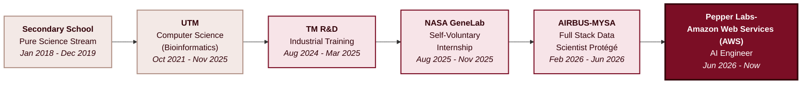

<div align="center">


<p><b>Bioinformatics Engineer · Solution Architect · Cloud Engineer · AI Engineer · Data Scientist<br/>Data Engineer · Data Analyst · Backend Engineer · Full Stack Developer</b></p>

<a href="https://github.com/aisyahmnadzri"></a>

<br/>

<a href="https://linkedin.com/in/aisyahnadzri"></a>
<a href="mailto:aisyahmnadzri@gmail.com"></a>

</div>

---

## 🧭 Who I Am

> I am a **Cloud Engineer cum AI Engineer**. I'm currently upgrading my skillset to cloud technology services and expanding into applications of AI engineering. My foundation is processing data, building ML models, building data pipelines and developing dynamic systems and web applications. My experience is wide because I don't limit my curiosity: I've worked with **biological data, financial data, earth and space data, governance and sovereign data**, and many more.

```python
class Aisyah:
    role      = "AI Engineer @ Pepper Labs-Amazon Web Services (AWS)"
    degree    = "BSc Computer Science (Bioinformatics), UTM"
    superpowers = ["AWS", "GCP", "ETL/ELT pipelines", "ML & deep learning", "FastAPI services", "Dashboards"]
    challenge = "1 Week, 1 Challenge"   # learn something, build something, repeat

    def say_hi(self):
        return "Let's build everything! 👋"
```

## 🗺️ My Professional Experience Roadmap



## My Expertise in Percentage

```text
Solution Architect    ██████████████░░░░░░  70%
Cloud Engineer        ██████████████░░░░░░  70%
AI Engineer           ██████████████████░░  90%
Data Scientist        ██████████████████░░  90%
Data Engineer         █████████████████░░░  85%
Data Analyst          █████████████████░░░  85%
Backend Engineer      ████████████████░░░░  80%
Full Stack Developer  ████████████████░░░░  80%
```

## 🧰 Toolbox

<details open>
  <summary><b>💻 Languages</b></summary>
  <br/>

  
  
  
  
  
  

</details>

<details>
  <summary><b>🌐 Frameworks & Libraries</b></summary>
  <br/>

  
  
  
  
  
  
  

</details>

<details>
  <summary><b>🧠 ML / DL / AI</b></summary>
  <br/>

  
  
  
  
  
  
  
  
  

</details>

<details>
  <summary><b>☁️ Databases, Data & Cloud</b></summary>
  <br/>

  
  
  
  
  
  
  
  
  
  

</details>

<details>
  <summary><b>🔧 Tools</b></summary>
  <br/>

  
  
  
  
  
  
  

</details>

## 📈 Activity

<div align="center">

| 🔥 Contributions | 💬 Top Languages |
| :---: | :---: |
|  |  |

</div>

## 🤝 Let's Connect

Got an idea, a dataset, or a data problem you're stuck on? I'd love to hear about it. Message me on [LinkedIn](https://linkedin.com/in/aisyahnadzri) or at [aisyahmnadzri@gmail.com](mailto:aisyahmnadzri@gmail.com).


